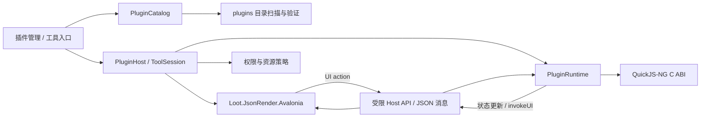

# Loot 插件与小工具技术设计

> 状态：首轮实现
>
> 日期：2026-11-08

## 1. 背景与目标

Loot 需要提供插件扩展能力。一个插件是安装在 Loot 数据目录中的扩展包；插件可以声明一个或多个带 UI 的小工具，用户可以在应用内打开它们。小工具的 UI 使用 Vercel `json-render` 的 JSON spec 思路描述，由 Loot 的 Avalonia 实现渲染；业务逻辑使用 JavaScript，运行在 QuickJS-NG 引擎中。

本设计覆盖：插件包格式、插件发现和生命周期、Avalonia 渲染器边界、QuickJS-NG 托管、UI 与脚本通信、权限与资源限制、持久化及分阶段交付。

目标：

- 安装、发现、启用、禁用和移除本地插件。
- 一个插件可包含多个小工具；每个小工具在 Loot 中有独立入口和窗口/页面实例。
- 以受控的组件目录呈现 JSON UI，不执行插件自定义 XAML、HTML 或任意原生代码。
- 为脚本提供版本化、最小权限的 Loot API，不把 .NET 对象或任意文件/网络能力直接暴露给脚本。
- 让插件在数据目录切换、热重载失败和应用关闭时有清晰生命周期。

非目标（首期）：远程插件市场、自动更新、插件间通信、第三方 .NET 程序集加载、WebView 渲染、任意 Avalonia 控件注入，以及对不可信脚本的 OS 级强隔离。

## 2. 设计决定

| 领域 | 决定 |
|---|---|
| 安装位置 | `AppPaths.ApplicationDataDirectory/plugins/<plugin-id>/` |
| UI 格式 | 采用 json-render 的扁平 spec：`root` + `elements`，首期实现 Loot 明确支持的组件和 action 子集 |
| UI 实现 | 新建独立 `Loot.JsonRender.Avalonia` 项目；插件加载和 JS 引擎不依赖 Avalonia 控件类型 |
| JS 引擎 | QuickJS-NG C 库通过小型原生桥接层接入；C# 通过稳定的 C ABI 调用，具体 NuGet 封装需在原型阶段评估 |
| 执行模型 | 每个已打开的小工具拥有独立 JS runtime/context；脚本不直接在 UI 线程执行 |
| 插件 API | Host 提供白名单 API；所有跨边界数据使用受限 JSON DTO |
| UI 事件 | 控件事件路由到声明过的 action，再异步调用脚本导出的 handler |
| 失败策略 | 插件解析、脚本启动或渲染失败只隔离该插件/工具，Loot 主进程继续工作 |

### 2.1 json-render 兼容性范围

上游 `json-render` 是生成式 UI 框架及多前端渲染生态；其当前 spec 示例使用扁平的 `root` / `elements` 结构，元素含 `type`、`props`、`children`。Loot 并不在 .NET/Avalonia 中复用上游 React/Vue 运行时，而是实现相同 spec 形状和经筛选的组件目录。该策略使插件可沿用核心树结构，但不承诺所有上游组件、指令、动态表达式、流式 spec 或其他 renderer 的扩展都能直接工作。升级兼容范围应通过 `schemaVersion` 和 renderer 版本策略管理。

## 3. 当前 Loot 架构接入点

- `AppPaths` 保存当前应用数据目录；新增 `PluginsDirectory` 属性，并在 `EnsureCreated()` 中创建目录。
- `ServiceCollectionExtensions.AddLootApplication()` 是生产服务组合根；注册插件目录服务、manifest reader、catalog、工具运行服务和管理窗口 ViewModel。
- `IWindowNavigationService` 当前负责窗口导航；可扩展打开小工具的入口，或引入独立 `IPluginWindowService`，避免将插件生命周期塞入通用导航接口。
- 设置页采用 scoped window/ViewModel。插件管理页面可以延续该模式；小工具实例也应使用独立 scope，关闭时释放订阅和脚本运行时。
- 插件配置、授权和启用状态属于当前数据目录，不应在开发者机器或另一数据目录之间共享。首期建议使用文件元数据，不增加 SQLite schema；后续若需查询/迁移再评估数据库。

## 4. 总体架构



逻辑项目建议拆分如下（具体名称可以随解决方案约定调整）：

1. **`Loot.Plugin.Abstractions`**：manifest、工具定义、spec DTO、能力声明、消息协议和 API 版本常量。只依赖 BCL。
2. **`Loot.PluginRuntime`**：目录发现、包校验、启停、session、权限代理和脚本运行时接口。通过 `IJavaScriptRuntime` 抽象 JS 引擎。
3. **`Loot.JsonRender.Avalonia`**：独立 Avalonia 项目，负责 spec 验证、控件目录、Avalonia 控件树和 action 事件。不引用 QuickJS、具体插件扫描器。
4. **`Loot.QuickJs`（或 `Loot.PluginRuntime.QuickJs`）**：QuickJS-NG 原生构建/装载、P/Invoke、安全封装和运行时适配。与 Avalonia 分离。
5. **`Loot` 主程序**：插件管理 UI、菜单入口、服务注册、Host API 的 Loot 实现和数据目录集成。

运行时接口示例（概念）：

```csharp
public interface IJavaScriptRuntime : IAsyncDisposable
{
    Task InitializeAsync(PluginScriptContext context, CancellationToken cancellationToken);
    Task<JsonElement?> InvokeAsync(string function, JsonElement? argument, CancellationToken cancellationToken);
    Task DispatchEventAsync(string action, JsonElement payload, CancellationToken cancellationToken);
}
```

所有 runtime 调用由 session 专用队列串行化，确保同一个 QuickJS context 不被多个线程并发访问；native runtime 的创建和释放遵守 QuickJS API 的线程约束。同步原生调用中如发生事件循环或 Promise 工作，Host 需提供有界的作业泵和取消策略，不能阻塞 Avalonia Dispatcher。

## 5. 插件目录与包格式

### 5.1 目录布局

```text
<Loot 数据目录>/
  plugins/
    <plugin-id>/
      plugin.json
      tools/
        <tool-id>/
          ui.json
          main.js
          assets/                 # 可选，只能由 Loot 的受控资源服务读取
      data/                       # 可选，插件私有持久化目录（运行时创建）
      state.json                  # 可选，启用状态/已授权能力等 Host 元数据
```

`plugins` 存储插件定义；`data/<plugin-id>` 或插件目录下的 `data/` 存储插件运行时数据。推荐目录分离：应用每次扫描安装根下的只读定义，Host 数据写入 `<data>/plugins-data/<plugin-id>/`，避免禁用或升级时误删用户数据。需在落地时保持约定单一。

插件包以目录作为运行格式。安装归档（建议 `.lootplugin`，内部 ZIP）解压前必须检查路径穿越、重复路径、大小限制和符号链接；先解压到同级 staging 目录，校验成功后原子 rename 到 `<plugin-id>`。禁止覆盖其他插件 ID；升级先备份或 staging 替换，失败回滚。首期可只支持从文件夹导入，包格式与导入 API 不变。

插件 ID：小写 ASCII，建议反向域名或 `author.name`，仅允许 `[a-z0-9][a-z0-9._-]{1,127}`，不可包含路径分隔符。工具 ID 在插件内唯一并遵循相同规范。大小写折叠后比较，拒绝冲突。

### 5.2 Manifest

建议 `plugin.json`：

```json
{
  "manifestVersion": 1,
  "id": "sample.hello",
  "name": "Hello 工具集",
  "version": "1.0.0",
  "description": "插件示例",
  "author": "Loot 社区",
  "loot": { "minVersion": "0.1.0", "maxVersion": "1.x" },
  "runtime": { "apiVersion": 1, "entry": "tools/hello/main.js" },
  "tools": [
    {
      "id": "hello",
      "name": "问候",
      "description": "生成问候语",
      "ui": "tools/hello/ui.json",
      "entry": "tools/hello/main.js",
      "icon": "assets/hello.png"
    }
  ],
  "capabilities": []
}
```

`runtime.entry` 可省略；建议每个 tool 独立入口，插件级公用 JS 可通过 Host 定义的本地模块加载器共享。首期为缩小 QuickJS ES module 解析范围，优先采用单一入口脚本 + Host 注入 `loot` 全局，不支持动态 `import()`、Node.js、CommonJS、npm 包或从网络加载模块。若工具脚本独立，manifest 的 `runtime.entry` 可以由 tool 定义覆盖。

校验规则：只读 UTF-8 JSON，拒绝重复键、未知 manifest 主版本、缺少必填字段、无效语义版本、超出当前 src/Loot/API 兼容区间、越出插件根目录的路径、超限文件、无效工具 ID 和重复工具 ID。路径处理必须 canonicalize 并确认最终路径仍在插件根目录下；拒绝符号链接作为入口/资源路径。未知扩展字段应忽略或保留，便于前向扩展。

## 6. 小工具 UI 规范与 Avalonia 渲染

### 6.1 Spec

首期 `ui.json` 使用 json-render 扁平树格式：

```json
{
  "root": "page",
  "elements": {
    "page": { "type": "Column", "props": { "spacing": 12 }, "children": ["title", "input", "submit", "result"] },
    "title": { "type": "Text", "props": { "text": "问候工具", "variant": "title" }, "children": [] },
    "input": { "type": "TextField", "props": { "label": "名字", "value": "", "statePath": "/name" }, "children": [] },
    "submit": { "type": "Button", "props": { "text": "生成", "action": "greet" }, "children": [] },
    "result": { "type": "Text", "props": { "text": { "$state": "/greeting" } }, "children": [] }
  }
}
```

上例展示建议的初期约定。最终标准字段要由 `Loot.Plugin.Abstractions` 中 DTO/JSON Schema 固定；对上游格式的非标准扩展必须进入 `loot` 命名空间或独立 schema 版本。禁止 spec 指定 CLR 类型名、XAML、binding expression、任意类名、任意样式对象和可执行表达式。

当前 Avalonia renderer 组件目录：

- 布局：`Column`、`Stack`、`VStack`、`Row`、`HStack`、`Card`（含 `header`/`footer` slots）、`CardHeader`、`CardFooter`、`Group`、`Panel`、`ScrollViewer`、`ScrollView`、`Divider`、`Separator`。
- 内容：`Text`、`Label`、`Icon`、`Avatar`、`Metric`、`Badge`、`Tag`、`Alert`。
- 输入：`TextField`、`TextInput`、`TextBox`、`Input`、`TextArea`、`TextAreaField`、`Textarea`、`NumberField`、`NumberInput`、`PasswordField`、`CheckBox`、`Checkbox`、`Switch`、`ToggleSwitch`、`Select`、`ComboBox`、`RadioGroup`、`Slider`、`DatePicker`、`ToggleButton`。
- 操作及反馈：`Button`、`IconButton`、`Progress`、`ProgressBar`。按钮通过 `props.action` 分发插件脚本 action，可用 `props.params` 声明参数。
- 未实现：图片、表格、图表、富文本及上游 renderer 特有能力。

状态/spec 能力包括顶层 `state`、JSON Pointer `$state`、`$bindState`、repeat 范围内的 `$item`/`$index`/`$bindItem`、`$template`、`$cond`、可注册 `$computed` 函数及 `concat`/`sum`/`uppercase`/`lowercase`/`join` 内置函数；`visible` 支持真值、比较、取反、AND 数组和 `$or`；repeat 支持嵌套 `$item` 数组路径；`watch` 在对应状态路径改变时触发 action。`children` 与 named `slots` 均可解析。

动态 UI 在状态变化时刷新；文本输入会在失焦时刷新视图以避免每次按键都重建输入控件。上游 directives、完整 schema/catalog 校验、内建表单 validation、流式 SpecStream 和 React/Vue/Svelte renderer 生命周期仍不支持。

当前 renderer 对 spec 结构、根节点、元素引用、循环、深度、总控件数和 repeat 数量做校验；每种组件的完整 JSON Schema 校验及按 JSON 路径报告未知属性仍未实现。未知组件会使当前小工具显示渲染错误，不影响 Loot 主程序。

### 6.2 Avalonia 项目职责

`Loot.JsonRender.Avalonia` 通过 `JsonRenderComponentRegistry` 注册 `type → JsonRenderComponentFactory`，默认工厂按布局、内容、表单和反馈拆分到独立模块。`JsonRenderComponentContext` 提供解析后的 props、children、named slots、状态绑定和 action 发射接口。主机可以注册受信任的自定义控件；插件 JSON 只能引用主机注册的名称，不能携带或加载控件代码。父子关系由 `children` ID 决定。

状态以调用方提供的 `JsonObject` 作为单个工具窗口的 state store，输入通过 JSON Pointer 更新；UI state 不跨工具窗口共享。当前状态变化会触发 UI spec 重建；文本输入延迟到失焦后刷新，后续可在状态依赖关系稳定后优化为节点级刷新。spec 表达式由 renderer 的受限 resolver 处理，不执行 JavaScript 或任意 .NET 表达式。持久化仍需由 manifest 明确 opt-in，并写入 Host 分配的数据目录。

### 6.3 UI Actions 与脚本回调

- `Button.props.action` 必须是 action ID 字符串，触发 `tool.onAction(actionId, payload)`。
- `TextField` 等值控件通过声明的 `statePath` 更新 UI state；若脚本需实时监听，另发 `stateChanged` 消息（需节流和大小限制）。
- 脚本通过 `loot.ui.setState(patch)` 更新状态；Host 合并并校验 patch 后通知 UI 线程更新。
- 脚本不得操作 Avalonia 控件或同步调用 UI Dispatcher；所有跨边界结果以 JSON 序列化。
- UI action 可以声明 confirm 要求（例如敏感操作），由 Host 渲染确认后再 dispatch。

## 7. QuickJS-NG 接入与脚本 API

### 7.1 原生集成

QuickJS-NG 是可嵌入的 C JavaScript 引擎。建议构建/打包 QuickJS-NG 的精简原生库（Windows x64/arm64、macOS x64/arm64、Linux x64/arm64 按 Loot 的发布矩阵），对外提供 Loot 自有、版本化的 C ABI shim，不让托管层直接依赖 QuickJS 内部符号。shim 负责 runtime/context 创建销毁、源代码求值、函数调用、JSON 值转换、异常提取、中断处理和内存统计。

原生 ABI 最小面：`loot_qjs_create(options)`、`loot_qjs_eval(source, filename)`、`loot_qjs_call(function, json)`、`loot_qjs_interrupt()`、`loot_qjs_destroy()`。句柄生命周期由 C# `SafeHandle` 管理。每个插件 session 单独 runtime/context；共享 runtime 会造成内存、执行中断和状态隔离困难。

禁用 QuickJS-NG 自带 CLI 的文件/进程能力和未经审查的 `std`、`os` 等宿主对象；只注册 Loot 明确提供的 API。QuickJS 支持 ECMAScript，不代表自动获得浏览器 DOM、Node.js 模块或 Web API。异步 API 需定义 Promise/作业队列由谁推进及如何取消。

原生分发是主要工程风险：应尽早验证各平台构建链、RID 映射、签名/公证、单文件发布装载方式和 macOS/Linux 打包。若原生库无法稳定随应用分发，再比较受维护的托管封装，但不能退化为执行外部 `qjs` 子进程的方案。

### 7.2 JS 编程模型

```js
globalThis.plugin = {
  onOpen() {
    loot.ui.setState({ greeting: "请输入名字" });
  },
  onAction(action, payload) {
    if (action === "greet") {
      const name = String(payload.name ?? "朋友").slice(0, 80);
      loot.ui.setState({ greeting: `你好，${name}！` });
    }
  }
};
```

首期采用全局 `plugin` 对象导出，尚不支持 ES module loader。`payload` 是 UI 当前 state 的浅层 JSON 对象。Host API 目前仅实现 `loot.ui.setState(patch)` 和 `loot.ui.notify(message)`，patch 只合并 state 顶层属性。建议后续再增加：

- `loot.ui.getState()`、`loot.ui.notify(message, level)`。
- `loot.storage.get(key)`、`loot.storage.set(key, value)`，仅插件私有存储，配额受限。
- `loot.host.getLocale()` 等只读环境信息。
- 通过 capabilities 显式允许的服务，例如 `loot.clipboard.read/write`、`loot.http.fetch`；首期可不提供网络 API。

所有异步 Host API 需 Promise 化；每个 API 检查 session 是否存活、能力是否授权、输入长度和速率限制。禁止 `eval` 可否需要允许应在原型中评估；无论是否允许，不能把脚本当作可信代码。

## 8. 生命周期与运行流程

### 8.1 启动发现

1. 数据目录初始化后创建 `plugins` 目录。
2. `PluginCatalog` 枚举一级插件目录，拒绝 reparse point/symlink，解析并验证 manifest。
3. 每个插件形成状态记录：`Discovered`、`Invalid`、`Disabled`、`Enabled`、`Running`、`Faulted`。
4. 未授权的新能力不会自动启用；插件可显示在管理列表，但需用户启用/授权后可运行。
5. 每插件错误写日志并保留在管理页，不能中断其它插件扫描或 Loot 启动。

### 8.2 打开工具

`用户选择工具 → 检查插件 enabled/兼容/授权 → 建立 session scope → 创建 QuickJS runtime → 注入 Host API → 加载并执行入口 → 校验 ui.json → UI Dispatcher 构建 Avalonia 控件树 → 调用 onOpen → 显示工具窗口/内容页`

UI 可先构建再调用 `onOpen`，避免脚本报错时空白窗口；初始化错误应在工具视图中显示可恢复错误页。关闭时阻止新请求、取消正在等待的 Host API、销毁 JS context 和 runtime、清理事件订阅和 scope。

### 8.3 禁用与移除

禁用插件：阻止新 session，提示或关闭现有工具实例，取消运行任务，释放 runtime，保存授权/启用状态。移除插件前关闭 session，再将定义目录移动至 trash/staging 后删除或由用户确认；永不默认删除插件数据。数据目录切换时应释放所有 session 并从新的 `AppPaths` 重新扫描。

首期不支持对运行中的插件原地热更新。文件变更只标记 catalog 需要刷新；必须关闭工具后重载，避免磁盘内容和正在执行的脚本版本不一致。

## 9. 安全模型

插件 JS 虽运行于嵌入式引擎，仍是 Loot 进程内代码，native bug 或宿主 API 漏洞可能影响整个应用；QuickJS 隔离不等同 OS sandbox。首期按“用户安装/授权的本地代码”信任等级设计，未来如支持第三方商店或自动安装，应另行引入进程隔离方案。

基础保护：

- **权限默认拒绝**：插件 manifest 声明能力；授权记录按插件 ID + 版本/能力保存。新增能力需重新授权。权限用白名单 API 实施，不以 UI 隐藏代替权限检查。
- **执行限制**：设置 QuickJS memory limit、stack limit、最大执行时间、中断 handler；用有限循环防止无限循环。单次事件串行处理，限制队列长度和 Promise/作业数量。超限则中断本 session，提供重试/禁用入口。
- **线程隔离**：QuickJS 不运行在 UI 线程；native 执行仍在进程内，长运行调用要有中断路径。不能保证对任意 native hang 安全终止。
- **文件访问**：首期脚本不能直接读写任意路径。插件私有存储通过键值 API 或受控文件 API；Host canonicalize 并验证根目录，拒绝 traversal、symlink 和设备文件。
- **网络访问**：默认无网络；将来若开放，只允许 Host 代发请求并检查能力、scheme、重定向、超时、响应大小，必要时加入域名 allowlist。避免直接注入 `fetch`。
- **UI 安全**：只渲染 catalog 组件；文本作为文本显示，URL scheme 限制，图片限大小/格式/路径；不执行 HTML、CSS 或脚本绑定。
- **资源与日志**：manifest、spec、脚本源码、消息、UI 树深度/节点数/文本长度均设上限；日志不默认记录敏感请求参数或插件私有数据。
- **安装安全**：归档解压防 zip-slip、重复路径、压缩炸弹和 symlink；可选校验 SHA-256；如市场发布再增加签名与发布者信任模型。
- **供应链**：锁定 QuickJS-NG 版本/commit，检查 MIT 许可和上游安全公告，发布时带第三方 notices；shim 保持窄小并审计内存/错误处理。

建议初始限制以配置常量集中管理，先给保守值再按典型工具实测校准：例如 spec 500 节点、JSON 单文件 1 MiB、脚本 2 MiB、UI 状态 1 MiB、单次 action 默认 2 秒、JS heap 32 MiB。具体默认值是设计提案，不应视为最终产品承诺；QuickJS 中断粒度和 native 内存统计需验证。

## 10. 错误处理与可观测性

错误分类：`ManifestInvalid`、`UnsupportedApiVersion`、`PermissionDenied`、`UiSpecInvalid`、`UnknownComponent`、`ScriptCompileError`、`ScriptRuntimeError`、`ExecutionLimitExceeded`、`HostApiError`、`NativeRuntimeUnavailable`。向用户显示简明信息、插件/工具 ID 和可复制诊断 ID；详细栈和原生错误写 Loot 日志，脚本异常应包含文件名、行列号（若 QuickJS API 可得）。

插件管理页显示插件名称、版本、来源路径、兼容状态、启用状态、能力授权、最近错误。不要把脚本 console 输出当作可信诊断；可提供 `loot.log` 受限接口并做长度/频率截断。

## 11. 配置、版本与兼容

- `manifestVersion` 表示包格式版本；`runtime.apiVersion` 表示 Host JS API 主版本；`ui.schemaVersion` 可在 ui.json 顶层或 manifest 单独字段声明。
- Loot 版本通过 manifest 的 `loot.minVersion` / `maxVersion` 检查。版本不兼容时可显示但不运行。
- Renderer catalog 采用语义化版本。新增可选组件可向后兼容；组件移除、props 语义改变或 action 协议改变要升级 schema/API 主版本。
- 插件启用和 capability grants 存在 Host 管理的 `plugins-state.json`，写入采用临时文件 + 原子替换。不要信任插件自行声明的授权状态。
- 插件私有数据按 plugin ID 隔离；升级时保留数据并可由插件 migration API 迁移，migration 有超时/备份。卸载时默认保留并提供单独清理操作。

## 12. 开发、验证和交付阶段

1. **接口原型**：确定 json-render spec 最小兼容范围、component schemas、脚本导出约定和消息 DTO；写一个样例插件，不接 QuickJS。
2. **Avalonia renderer**：建立独立项目，实现静态 spec 的校验、组件映射、状态绑定、action 回调和预览样例。
3. **插件目录与管理**：扩展 `AppPaths`，实现 manifest 扫描、兼容检查、管理页面、启用状态、导入 staging 与路径安全。
4. **QuickJS 原生原型**：先打通一个平台从 C ABI 创建 runtime、求值、调用 JS、序列化 JSON、异常和中断；再扩展到其他 RID 和发布打包。
5. **Runtime bridge**：串联 UI action、脚本 handler、状态更新、Promise 及取消，并加入 session scope 生命周期。
6. **权限与资源限制**：完成 capability 授权 UX、QuickJS 限额、文件隔离、故障隔离、日志分类。
7. **多平台发布验证**：CI 构建原生库及主程序；验证安装器、签名、公证、原生库缺失时的友好降级。

交付验收标准：有效插件可被发现并打开；无效插件不会阻断 Loot 启动；未知组件、错误脚本、缺失原生库均有可读错误；action 与状态能双向更新；插件禁用/关闭释放 session；脚本无 Loot API 权限时无法越权访问；路径穿越包无法安装；数据目录切换后只加载新目录插件；发布制品包含对应平台原生库及许可说明。

## 13. 主要风险与待原型确认项

1. QuickJS-NG C 库的跨平台编译、维护成本和 Avalonia 单文件/安装包中的原生库加载方式。
2. QuickJS promise job queue、异步 Host callback 与线程切换的正确执行模型。
3. `json-render` 上游 schema 和指令演进频繁；必须建立本项目锁定的 spec fixtures 和兼容版本，不能声称支持上游全部能力。
4. 进程内 JS 沙箱不是安全边界；如果插件来源从本地可信扩展变成开放市场，需将 Runtime 抽成独立受限进程并设计 IPC 权限协议。
5. 开发 API 的用户体验与最小权限可能需要更易用的 capability 描述及首次运行授权页面。
6. 需要决定初版插件导入来源、签名是否强制、卸载时数据清理 UX、工具呈现为独立窗口还是主窗口标签页。

## 14. 上游参考

- [vercel-labs/json-render README](https://github.com/vercel-labs/json-render)：spec 树、catalog 和多框架 renderer 的上游定义；本文引用其 `root` / `elements` 扁平 spec 示例。
- [quickjs-ng/quickjs README](https://github.com/quickjs-ng/quickjs)：QuickJS-NG 的 C 引擎定位及上游项目入口。

设计基于上述仓库在编写日期可见的文档；实现前需再次核对上游 API、许可证、发布工件和安全信息，并将采用的 commit/version 固定在构建配置中。

## 15. 当前代码实现范围

此节记录首轮落地范围；未列入的能力仍按上文规划推进：

- 已实现插件根目录、JSON manifest 扫描、启用状态文件、目录安装和 `.lootplugin`/ZIP 安装、包路径校验、符号链接拒绝、50 MiB 解压限制、卸载确认以及插件私有数据目录保留。
- `Loot.JsonRender.Avalonia` 是独立项目；组件和状态表达式的当前支持范围见 §6.1。`root`/`elements`、树深度、循环引用、渲染控件数和文件大小会被限制。
- JS 使用 `globalThis.plugin.onOpen` / `onAction`；本机 QuickJS-NG C shim 提供每实例 32 MiB heap、1 MiB stack 和每次调用约 2 秒 CPU 时间限制。`loot.ui.setState` 与 `notify` 已接通。
- 原生 shim 使用 QuickJS-NG `v0.18.0` 源码。macOS/Linux Debug 构建会用本机 C 编译器自动构建并复制到应用输出目录；Windows 和发布构建使用 `src/native/quickjs/CMakeLists.txt`。发布工作流设置 `BuildQuickJsNative=true` 并将库放入制品目录。
- 暂未实现 storage API、网络/剪贴板等宿主能力和 capability 授权界面；因此当前 manifest 声明任何 capability 都会被拒绝。暂未实现图片组件、模块导入、工具数据迁移、在线市场及跨进程隔离。
